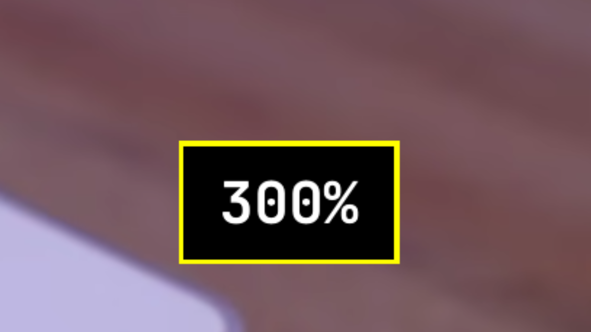

# Magnifier for Omarchy

A screen magnifier for low-vision users of [Omarchy](https://omarchy.org/). Zoom with the scroll wheel, a key or a pinch, see the zoom level in a big popup beside the pointer, and on a two-monitor desk give each monitor its own pointer and its own zoom level.



## Hotkeys

| Keys | What happens |
|---|---|
| `Ctrl + Alt + Scroll up` | Zoom in by one step |
| `Ctrl + Alt + Scroll down` | Zoom out by one step |
| `Ctrl + Alt + Z` | Zoom to the preset (300%) |
| `Ctrl + Alt + X` | Zoom off (100%) |
| `Ctrl + Alt + I` | Invert the colours of every screen (press again to restore) |
| `Super + Pinch` on the touchpad | Zoom in and out continuously |
| `Super + Ctrl + Scroll down` | Jump to the next monitor |
| `Super + Ctrl + Scroll up` | Jump to the previous monitor |
| `Super + Ctrl + M` | Unlock or lock the mouse (two or more monitors) |
| `Super + front side button` | Zoom to the preset (only when `side_buttons = true`) |
| `Super + back side button` | Zoom off (only when `side_buttons = true`) |

Every change shows the new zoom percentage in a popup next to the pointer. The popup follows the active Omarchy theme.

Omarchy's own `Super + Ctrl + Z` (zoom in) and `Super + Ctrl + Alt + Z` (zoom reset) keep working. The plugin keeps their result inside your limits and remembers it across reloads, like its own keys.

Every key can be changed or switched off in the settings. All plugin keys show up in Omarchy's hotkey list (`Super + K`) under "Magnifier".

## Requirements

- Omarchy 4 (Quattro) with the Lua Hyprland config (`~/.config/hypr/hyprland.lua`). The plugin does not work on Omarchy 3 and its `.conf` files.
- Hyprland 0.56 or newer, which Omarchy 4 ships.

External dependencies: none. Everything the plugin uses is part of a stock Omarchy 4 install: Hyprland with its Lua config, `omarchy-shell`, `hyprctl`, and `jq` (used by the command line tool). Nothing is downloaded and nothing needs `sudo`.

## Install

Two steps. The first adds the plugin to Omarchy. The second connects it to Hyprland.

```bash
omarchy plugin add https://github.com/JPDoesDev/omarchy-magnifier --enable
~/.config/omarchy/plugins/jpdoesdev.magnifier/install.sh
```

`install.sh` does four things, and does each only once even if you run it again:

1. Appends a marked settings block and the `dofile(...)` line to `~/.config/hypr/hyprland.lua`.
2. Symlinks `bin/omarchy-magnifier` into `~/.local/bin` so the command line tool is on your path.
3. Makes sure the popup plugin is enabled in `omarchy-shell`.
4. Reloads Hyprland and checks that the bindings and the popup answer.

That is all. Press `Ctrl + Alt + Z` and the screen zooms to 300% with a popup beside the pointer.

To update later run `omarchy plugin update jpdoesdev.magnifier`, then `hyprctl reload`.

## Settings

All settings live in one Lua table in `~/.config/hypr/hyprland.lua`. The table must come before the `dofile(...)` line. Every key is optional. A missing key, or one with the wrong type, falls back to its default, so a typo can never leave you without zoom.

A typical block, with the keys people change most often:

```lua
-- Omarchy Magnifier settings (every key is optional)
omarchy_magnifier = {
  preset_zoom = 3, -- Ctrl + Alt + Z goes here (3 = 300%)
  step = 1, -- change per scroll notch
  max_zoom = 10,
  side_buttons = false, -- set true for Super + mouse side buttons
  keys = {
    lock_toggle = "SUPER + CTRL + M",
  },
}
dofile(os.getenv("HOME") .. "/.config/omarchy/plugins/jpdoesdev.magnifier/hypr/init.lua")
```

A high-contrast popup, black with white text and a yellow border:

```lua
omarchy_magnifier = {
  osd_style = { background = "#000000", text = "#ffffff", border = "#ffff00" },
}
dofile(os.getenv("HOME") .. "/.config/omarchy/plugins/jpdoesdev.magnifier/hypr/init.lua")
```

After editing run `hyprctl reload`. The popup picks up style changes on the next zoom, with no shell restart.

Zoom levels are multipliers: 1 means off, 3 means 300%.

| Key | Default | What it does |
|---|---|---|
| `preset_zoom` | `3` | Zoom reached by the preset key and the front side button. |
| `off_zoom` | `1` | Zoom reached by the off key and the back side button. |
| `step` | `1` | Change per scroll notch. Smallest allowed value is 0.1. |
| `min_zoom` | `1` | Lowest zoom the plugin allows. Never below 1. |
| `max_zoom` | `10` | Highest zoom the plugin allows. Hyprland's own ceiling is 10. |
| `osd` | `true` | Show the zoom percentage beside the pointer on every change. |
| `pinch` | `true` | `Super + pinch` on the touchpad zooms continuously. |
| `pinch_fingers` | `2` | Fingers for the pinch gesture. |
| `pinch_zoom_level` | `1.0` | Hyprland's `zoom_level` for the `cursor_zoom` gesture. |
| `side_buttons` | `false` | Bind `Super + mouse side buttons` to preset and off. |
| `side_button_in` | `276` | Button code of the front side button on most mice. Find yours with `wev`. |
| `side_button_out` | `275` | Button code of the back side button. |
| `invert` | `true` | Enable colour inversion and its key. Inversion is always off after a reboot. |
| `jump` | `true` | `Super + Ctrl + scroll` hops between monitors with per-monitor memory. |
| `mouse_lock` | `true` | Keep the pointer on one monitor until a jump (two or more monitors). |
| `lock_gap` | `20000` | Logical pixels placed between monitors while locked. |
| `keys.zoom_in` | `"CTRL + ALT + mouse_up"` | Zoom in. Set to `false` to leave it unbound. |
| `keys.zoom_out` | `"CTRL + ALT + mouse_down"` | Zoom out. |
| `keys.preset` | `"CTRL + ALT + Z"` | Zoom to `preset_zoom`. |
| `keys.off` | `"CTRL + ALT + X"` | Zoom to `off_zoom`. |
| `keys.invert` | `"CTRL + ALT + I"` | Toggle colour inversion. |
| `keys.jump_next` | `"SUPER + CTRL + mouse_down"` | Jump to the next monitor. |
| `keys.jump_prev` | `"SUPER + CTRL + mouse_up"` | Jump to the previous monitor. |
| `keys.lock_toggle` | `"SUPER + CTRL + M"` | Mouse lock on and off. |
| `osd_style.font_size` | `48` | Font size of the popup. |
| `osd_style.duration_ms` | `1200` | How long the popup stays, in milliseconds. |
| `osd_style.border_width` | `4` | Border width of the popup. |
| `osd_style.padding` | `15` | Space between the text and the border. |
| `osd_style.min_scale` | `2` | Smallest on-screen size as a multiple of normal. Below 2 looks blurry. |
| `osd_style.pointer_gap` | `104` | Horizontal distance from the pointer, in on-screen pixels. |
| `osd_style.pointer_drop` | `28` | Vertical offset from the pointer, in on-screen pixels. |
| `osd_style.background` | theme colour | Popup background. Set `"#rrggbb"` to force a colour. |
| `osd_style.text` | theme colour | Popup text colour. Set `"#rrggbb"` to force a colour. |
| `osd_style.border` | theme colour | Popup border colour. Set `"#rrggbb"` to force a colour. |

Key strings use Hyprland's Lua binding syntax: modifiers in capitals joined with `+`, then a key name, `mouse_up` or `mouse_down` for the wheel, or `mouse:NNN` for a button code. Any `keys.*` entry can be set to `false` to leave that chord unbound.

## Using two monitors

Hyprland's zoom is a whole-screen zoom that follows the pointer. On one monitor that is perfect. On two monitors it falls apart for low-vision use: the pointer drifts across the edge without you noticing and the zoom lands on the wrong monitor, there is one zoom level for the whole desk, and finding the pointer again on a wide monitor at high zoom is slow.

With two or more monitors the plugin turns the desk into independent screens. Each monitor keeps its own pointer position and its own zoom level, and one hotkey hops between them.

### Jump

`Super + Ctrl + Scroll down` jumps to the next monitor (left to right, wrapping). `Super + Ctrl + Scroll up` jumps back. The pointer lands where you last left it on that monitor and that monitor's own zoom level comes back. Keyboard focus moves with it. On a first visit the pointer lands in the centre with zoom off.

The zoom keys act on the monitor under the pointer. The level you set there is what the jump restores when you come back.

### Mouse lock

While locked, the mouse cannot drift from one monitor to the other. A jump is the only way across. This is the default whenever two or more monitors are connected.

`Super + Ctrl + M` unlocks the mouse so you can drag a window across. Press it again to lock. Plugging or unplugging a monitor locks again on its own. The unlock also ends at reboot.

With a single monitor the lock does nothing. Set `mouse_lock = false` to switch it off for good.

### Frozen zoom

The monitor you leave stays exactly as you saw it. If it was magnified it stays magnified at that spot, and the view keeps updating, so a video keeps playing in it. When you jump back the live magnifier takes over at the same spot. If it was at 100% it stays at 100%.

### Everyday examples

**Video on one monitor, work on the other.** Put the video on the second monitor. Jump to the first, zoom to 300% or more and work. The video keeps playing full size at 100%. Jump back when you want to watch, and your pointer is where you left it.

**Moving a window across.** Press `Super + Ctrl + M`, drag the window over, and press `Super + Ctrl + M` again.

**Reading a long page at high zoom.** Zoom in, read, and scroll with the normal wheel. The zoom and the pointer stay on this monitor however far you move the mouse.

**Starting over.** `Ctrl + Alt + X` zooms this monitor off. Jump to the other one and press it again. Or run `omarchy-magnifier unfreeze` to drop every frozen view at once.

## Command line

`install.sh` puts `omarchy-magnifier` on your path. It drives the same functions as the hotkeys, so it is handy for scripts and other bindings.

```bash
omarchy-magnifier zoom in          # one step in
omarchy-magnifier zoom out         # one step out
omarchy-magnifier zoom toggle      # preset if off, off if zoomed
omarchy-magnifier zoom preset      # go to preset_zoom
omarchy-magnifier zoom off         # go to off_zoom
omarchy-magnifier zoom set 4       # any level inside min_zoom..max_zoom
omarchy-magnifier zoom status      # print the current zoom factor
omarchy-magnifier invert toggle        # or on / off / status
omarchy-magnifier jump next        # same as Super + Ctrl + Scroll down
omarchy-magnifier jump prev        # same as Super + Ctrl + Scroll up
omarchy-magnifier lock on|off|toggle|status
omarchy-magnifier unfreeze         # drop every frozen view
omarchy-magnifier status           # zoom, lock state and frozen monitors in one go
```

The same functions are reachable from any Hyprland Lua file through the `OmarchyMagnifier` table, for example `hyprctl eval 'OmarchyMagnifier.zoom_set(4)'`.

## Limits and troubleshooting

### Known limits

- **One screen shader.** Frozen zoom and colour inversion share Hyprland's single screen-shader slot, generated into one shader so they work together. When a shader from somewhere else is active, for example a per-window inversion plugin, both are skipped and that shader is left alone. You get one notification about it. Jump and mouse lock still work; the monitor you leave simply drops to 100%.
- **GPU and battery while frozen.** While any monitor is frozen Hyprland renders full frames continuously so the frozen view keeps updating. That costs GPU time and battery. It stops as soon as nothing is frozen.
- **Reboot clears the memory.** Zoom, per-monitor memory and frozen views survive a Hyprland reload but are gone after a reboot.
- **Scale pills un-gap the layout.** Changing a monitor's SCALE in Omarchy's display panel applies a live rule with `position = "auto"`. That removes the gap between monitors until the next sync, so the mouse can cross. Press `Super + Ctrl + M` twice to lock again right away.
- **Three or more monitors** are handled, left to right with a gap between each, but only two have been tested.
- **Pinch is touchpad only.** Touchscreens are not supported by Hyprland's `cursor_zoom` gesture.
- **Mouse lock needs two monitors.** With one monitor it does nothing and tells you so.
- **The popup can look blurry below 200%.** `osd_style.min_scale` keeps it at least twice its normal size for that reason.

### Something does not work

Run these in a terminal, in this order.

```bash
hyprctl configerrors
```

Prints any error in your Hyprland config. A typo in the settings table shows up here. The plugin itself falls back to defaults on bad values, but a Lua syntax error stops the whole file.

```bash
hyprctl binds | grep -i magnifier
```

Lists the plugin's bindings. Expect eight with the default settings, ten with `side_buttons = true`. Nothing listed means the `dofile(...)` line is missing from `~/.config/hypr/hyprland.lua` or the plugin folder is not where it expects.

```bash
omarchy-shell magnifier ping
```

Checks that the popup plugin is loaded in the shell. If this fails run `omarchy plugin list` and make sure `jpdoesdev.magnifier` is enabled.

```bash
omarchy-shell magnifier show '{"zoom":3}'
```

Shows the popup by hand at 300%. If it appears, the shell side is fine and the problem is in Hyprland's side.

```bash
rm "$XDG_RUNTIME_DIR"/omarchy-magnifier-*; hyprctl reload
```

Forgets the saved zoom, the per-monitor memory and every frozen view, then reloads. Use it when a frozen view sticks, for example after a crash.

If the mouse stays locked after you turned the lock off, remove the rule file and reload:

```bash
rm -f ~/.local/state/omarchy/toggles/hypr/magnifier-mouse-lock.lua; hyprctl reload
```

## Removal

Two steps, the reverse of the install:

```bash
~/.config/omarchy/plugins/jpdoesdev.magnifier/install.sh --uninstall
omarchy plugin remove jpdoesdev.magnifier
```

`install.sh --uninstall` removes the marked settings block and the `dofile(...)` line from `~/.config/hypr/hyprland.lua`, removes the `~/.local/bin/omarchy-magnifier` symlink, deletes the mouse lock rule file and the runtime files, sets the zoom back to 100%, disables the popup plugin and reloads Hyprland. `omarchy plugin remove` then deletes the checkout. Nothing is left behind, and no `sudo` is needed at any point.

## How it works

Zoom is Hyprland's own `cursor:zoom_factor`. The plugin wraps it in Lua: it clamps every change to `min_zoom..max_zoom`, saves the level to `$XDG_RUNTIME_DIR/omarchy-magnifier-state` and puts it back when the config loads, because every Hyprland reload (a theme change, a monitor event, a toggle) resets the zoom to 1. A 500 ms timer catches changes the plugin did not make itself, such as the pinch gesture or Omarchy's own `Super + Ctrl + Z`, and keeps them within the limits too.

The popup is a shell plugin (`ZoomOsd.qml`, kind `panel`) inside `omarchy-shell`. Hyprland sends it the zoom and the style in one JSON payload over `omarchy-shell magnifier show`. Because the style travels with each call, the popup never reads a settings file and a reload is enough to change its look. Colours come from the active theme unless `osd_style` forces them.

Hyprland renders the zoom only on the monitor under the pointer. The jump (`hypr/jump.lua`) records the pointer position and zoom of the monitor you leave, moves focus and pointer to the remembered spot on the target, and restores the target's zoom. To keep the monitor you left magnified, `hypr/screenfx.lua` generates a screen shader that re-creates the same magnified view on that output alone, through the shader's `wl_output` uniform. Colour inversion is one more line in the same generated shader, applied to every output; its on/off flag is `$XDG_RUNTIME_DIR/omarchy-magnifier-inverted`. Frozen views are listed in `$XDG_RUNTIME_DIR/omarchy-magnifier-frozen` and the shader is written to `$XDG_RUNTIME_DIR/omarchy-magnifier.frag`.

Hyprland clamps pointer motion to the nearest monitor edge. The mouse lock (`hypr/lock.lua`) places the monitors far apart in the virtual layout, `lock_gap` logical pixels by default and always under Xwayland's coordinate limit, so no mouse movement can reach the other monitor. The gapped layout is written as monitor rules to `~/.local/state/omarchy/toggles/hypr/magnifier-mouse-lock.lua`, which Omarchy loads after your own `monitors.lua`. Each rule keeps the monitor's current mode, scale and rotation; only the position changes. Unlocking removes the file. The unlocked flag is `$XDG_RUNTIME_DIR/omarchy-magnifier-unlocked`.

The whole Hyprland side is loaded with one `dofile(...)` line rather than `require`. The plugin id contains a dot, which Lua's module path would turn into a directory separator, and `dofile` is never cached, so every `hyprctl reload` re-evaluates the plugin like the rest of your config.

## License

MIT. See [LICENSE](LICENSE). Copyright 2026 JPDoesDev.
